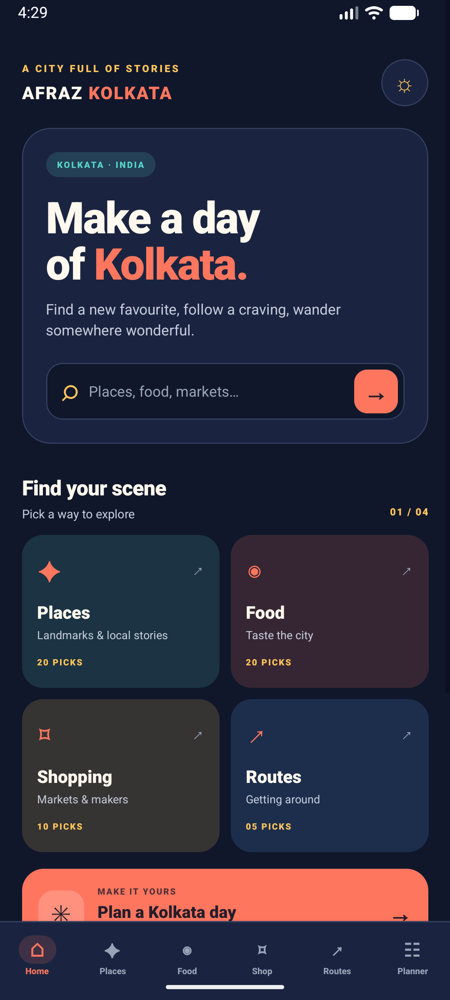
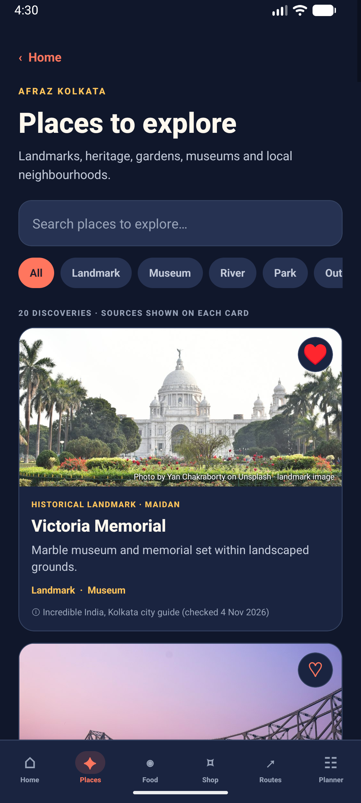
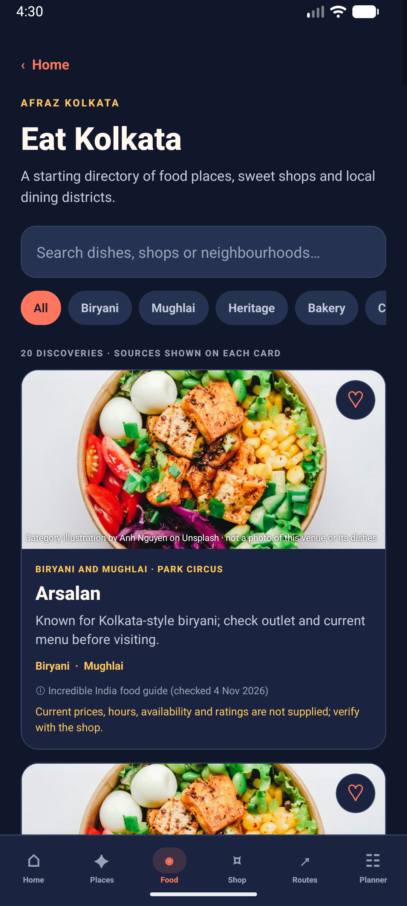
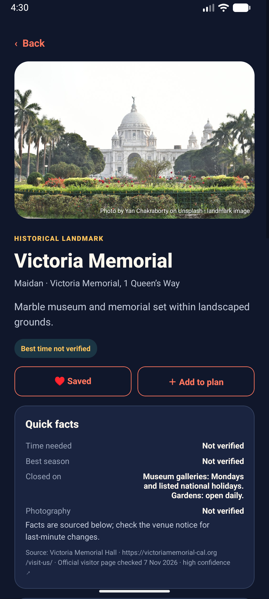
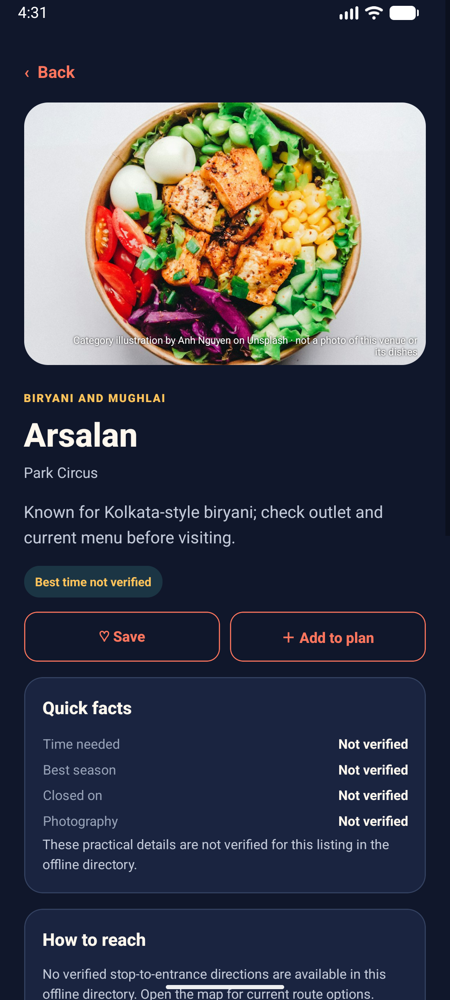
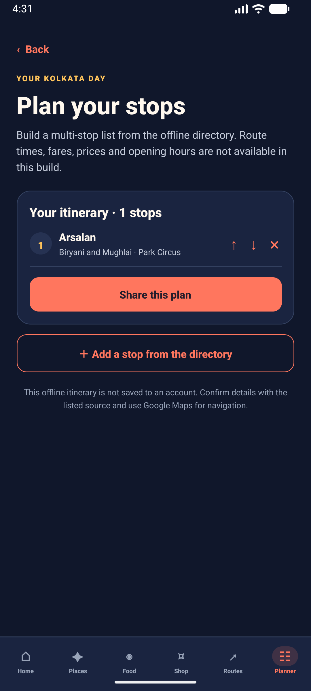
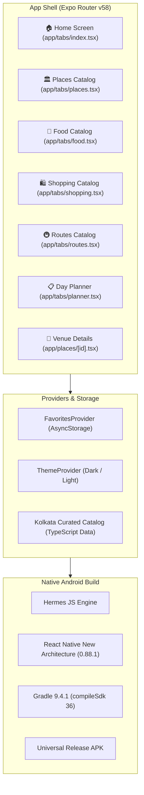

<p align="center">
  
</p>

<h1 align="center">Afraz Kolkata</h1>

<p align="center">
  <strong>A curated, source-verified discovery guide & offline day planner for Kolkata, India 🚖🏛️</strong>
</p>

<p align="center">
  <a href="https://github.com/Afraz-Dev-Pro/Afraz-Kolkata/releases"></a>
  <a href="https://github.com/Afraz-Dev-Pro/Afraz-Kolkata/actions"></a>
  <a href="https://reactnative.dev/"></a>
  <a href="https://docs.expo.dev/"></a>
  <a href="https://www.typescriptlang.org/"></a>
  <a href="https://developer.android.com/"></a>
</p>

---

## 📥 Download the Android APK

You can download and install **Afraz Kolkata** directly onto your Android device:

<table>
  <tr>
    <td align="center">
      <a href="https://github.com/Afraz-Dev-Pro/Afraz-Kolkata/releases">
        
      </a>
      <br />
      <em>Download <code>AfrazKolkata-v1.2.6.apk</code> from the official Releases page</em>
    </td>
    <td align="center">
      <a href="https://github.com/Afraz-Dev-Pro/Afraz-Kolkata/actions">
        
      </a>
      <br />
      <em>Grab the latest automated build artifact under GitHub Actions</em>
    </td>
    <td align="center">
      <a href="https://expo.dev/accounts/afrazvonlifas-team/projects/afraz-kolkata/builds/6580131b-41f3-48c8-adec-7a7399f33f64">
        
      </a>
      <br />
      <em>Direct preview link via Expo Application Services</em>
    </td>
  </tr>
</table>

### 📲 Quick Installation Guide (Android)

1. **Download APK**: Tap the green button above or grab [`AfrazKolkata-v1.2.6.apk`](https://github.com/Afraz-Dev-Pro/Afraz-Kolkata/releases).
2. **Open the File**: Tap on the completed download in your notifications or browser downloads folder.
3. **Allow Installation**: If prompted with *"For your security, your phone is not allowed to install unknown apps from this source"*, tap **Settings** and toggle **Allow from this source**.
4. **Install & Enjoy**: Tap **Install** and begin exploring Kolkata!

> [!NOTE]
> The universal APK is signed and compatible with Android 7.0 (Nougat, API 24) through Android 15+. It contains native libraries for `arm64-v8a`, `armeabi-v7a`, `x86`, and `x86_64`.

---

## 📱 App Showcase

<table align="center">
  <tr>
    <th width="33%" align="center">🏠 Home & Creator Hub</th>
    <th width="33%" align="center">🏛️ Places Directory</th>
    <th width="33%" align="center">🍛 Eat Kolkata</th>
  </tr>
  <tr>
    <td></td>
    <td></td>
    <td></td>
  </tr>
  <tr>
    <th width="33%" align="center">📖 Sourced Place Details</th>
    <th width="33%" align="center">🍲 Culinary Details & Tips</th>
    <th width="33%" align="center">📋 Multi-Stop Day Planner</th>
  </tr>
  <tr>
    <td></td>
    <td></td>
    <td></td>
  </tr>
</table>

---

## 🌟 Key Features

### 🏛️ 1. Curated Heritage & Cultural Destinations
- **20 Verified Places**: Explore the Victoria Memorial, Howrah Bridge, Dakshineswar Kali Temple, Indian Museum, Princep Ghat, Jorasanko Thakurbari, Marble Palace, and more.
- **Categorized Filters**: Filter by *Landmark*, *Museum*, *River*, *Park*, or *Outdoor*.
- **Practical Visitor Facts**: High-confidence entry hours, weekly holiday closures, photography policies, and one-tap directions via Google Maps URL schemes.

### 🍛 2. Authentic Kolkata Food Trail
- **20 Legendary Food Spots**: From iconic Kolkata Mughlai Biryani at *Arsalan* and Chelo Kebab at *Peter Cat*, to heritage sweetmakers *Girish Chandra Dey & Nakur Chandra Nandy*, *Flurys Tearoom*, and *Nizam’s Kathi Rolls*.
- **Cuisine Filters**: Instantly filter between *Biryani*, *Mughlai*, *Heritage*, *Bakery*, *Cabin*, *Sweets*, *Chinatown*, and *Bengali*.
- **Transparency First**: Category illustrations are explicitly labeled to avoid misleading photography.

### 🛍️ 3. Legendary Markets & Shopping Bazaars
- **10 Famous Shopping Hubs**: Discover *New Market (Sir Stuart Hogg Market)*, *College Street Boi Para*, *Gariahat Market*, *Burrabazar*, *Hatibagan*, *Dakshinapan*, and more.
- **Retail & Wholesale Context**: Clearly distinguishes market types, trade specialties, and neighborhood navigation leads.

### 🚇 4. Getting Around (Transit & Metro)
- **5 Verified Bus & Transit Routes**: Route cards connecting Howrah Station, Sealdah, Esplanade, Salt Lake Sector V, and Netaji Subhash Chandra Bose International Airport.
- **Metro Line Cross-References**: Detailed connections for Green Line (underwater East-West metro) and Blue Line (North-South corridor).

### 📋 5. Offline Multi-Stop Day Planner
- **Build Custom Itineraries**: Add any place, food stall, or market to your personal day plan with one tap.
- **Reorder & Organize**: Move stops up or down with responsive arrow controls.
- **Share Plans**: Share your day plan summary directly with travel companions via the native share sheet.

### ♥️ 6. Local Favorites
- **Offline Device Storage**: Heart any destination or eatery to save it to your local device favorites using `@react-native-async-storage/async-storage`.

### 🌓 7. High-Contrast Kolkata Themes
- **Warm Day & Night Themes**: Custom color system inspired by Kolkata's iconic yellow ambassadors, deep terracotta temples, and heritage river ghats.
- **One-Tap Theme Switcher**: Toggle smoothly between deep indigo dark mode and clean daylight mode.

### 🛡️ 8. Strict Data Sourcing & Anti-Hallucination
- **Truthful Provenance**: Factual assertions (costs, operating hours, closures) explicitly show verified source URLs, confidence levels, and last-checked dates.
- **No Guesses**: Unverified hours or menu prices are explicitly marked as *“Not verified”* rather than filled with AI hallucinations.

---

## 🛠️ Tech Stack & Architecture



| Layer | Technologies |
| :--- | :--- |
| **Framework** | [React Native 0.88.1](https://reactnative.dev/), [Expo SDK 58](https://expo.dev/) |
| **Routing** | [Expo Router v58](https://docs.expo.dev/router/introduction/) (File-based navigation with Tabs and Stack) |
| **Language** | [TypeScript 5.9](https://www.typescriptlang.org/) (Strict typing) |
| **Validation** | [Zod 4.1](https://zod.dev/) (Strict domain validation for places, reviews & sources) |
| **State & Storage** | React Context + [@react-native-async-storage/async-storage](https://react-native-async-storage.github.io/async-storage/) |
| **Backend / DB** | [Supabase](https://supabase.com/) (Edge functions & PostgreSQL RLS schemas prepared) |
| **Styling** | Native StyleSheet with theme tokens (Indigo, Saffron, Coral, Teal) |
| **Native Engine** | Hermes JavaScript Engine + New Architecture enabled |
| **CI/CD** | [GitHub Actions](https://github.com/features/actions) for automatic universal Android APK compilation |

---

## 📂 Repository Structure

```text
AfrazPlanner/
├── .github/
│   └── workflows/
│       └── build-apk.yml          # GitHub Actions Android APK build & release workflow
├── android/                       # Prebuild native Android project (Gradle 9.4.1)
│   ├── app/                       # Android app module with debug.keystore and build configs
│   └── gradlew                    # Gradle build wrapper
├── app/                           # Expo Router screens
│   ├── (tabs)/
│   │   ├── _layout.tsx            # Bottom tab bar navigation
│   │   ├── index.tsx              # Home screen with search, modules & About Me card
│   │   ├── places.tsx             # Curated places list
│   │   ├── food.tsx               # Curated food directory
│   │   ├── shopping.tsx           # Markets and bazaars directory
│   │   ├── routes.tsx             # Transit and bus routes directory
│   │   └── planner.tsx            # Multi-stop day planner screen
│   ├── places/
│   │   └── [id].tsx               # Detailed place/venue view with citation cards
│   ├── _layout.tsx                # Root stack navigator with theme provider
│   └── search.tsx                 # Universal keyword search
├── assets/                        # Branded icons and launcher artwork
│   ├── icon.png                   # High-res Victoria Memorial + Kolkata Taxi icon (1024x1024)
│   ├── icon.svg                   # Vector icon source
│   ├── icon-foreground.png        # Adaptive icon foreground
│   └── screenshots/               # High-resolution screenshots for README & docs
│       ├── home.png
│       ├── places.png
│       ├── food.png
│       ├── place-detail.png
│       ├── food-detail.png
│       └── planner.png
├── docs/                          # Architecture, PRD, testing & data source documentation
│   ├── ARCHITECTURE.md
│   ├── DATA_SOURCES.md
│   ├── KNOWN_LIMITATIONS.md
│   ├── PRD.md
│   ├── ROADMAP.md
│   └── SECURITY.md
├── src/
│   ├── components/                # Reusable UI components (CatalogScreen)
│   ├── data/                      # Sourced Kolkata catalog data & unit tests
│   │   ├── kolkataCatalog.ts
│   │   └── kolkataCatalog.test.ts
│   ├── domain/                    # Zod schemas and type definitions
│   │   └── place.ts
│   ├── providers/                 # Theme, Favorites, and External Linking providers
│   │   ├── FavoritesProvider.tsx
│   │   ├── googleMapsUrl.ts
│   │   └── supabase.ts
│   └── theme/                     # Kolkata warm palette definitions
│       ├── colors.ts
│       └── ThemeProvider.tsx
├── supabase/                      # Edge functions & database migrations
├── app.json                       # Expo configuration
├── eas.json                       # EAS build configurations
├── package.json                   # Project scripts and dependencies
└── tsconfig.json                  # TypeScript compiler settings
```

---

## 💻 Local Development Setup

### Prerequisites
- [Node.js](https://nodejs.org/) v20 or higher
- [pnpm](https://pnpm.io/) or [npm](https://www.npmjs.com/)
- Optional for native builds: [Android Studio](https://developer.android.com/studio) with Android SDK 34+ and JDK 17

### 1. Clone the Repository
```bash
git clone https://github.com/Afraz-Dev-Pro/Afraz-Kolkata.git
cd Afraz-Kolkata
```

### 2. Install Dependencies
```bash
pnpm install
# or
npm install
```

### 3. Run Quality Checks
```bash
# Type check TypeScript code
npm run typecheck

# Run unit tests
npm test

# Run ESLint
npm run lint
```

### 4. Start the Expo Development Server
```bash
npx expo start
```
Scan the QR code using Expo Go on your mobile device, or press `a` to open on an Android emulator.

### 5. Build Local Android APK
```bash
npm run build:apk:local
```
The output APK will be placed in `android/app/build/outputs/apk/release/app-release.apk`.

---

## 🤖 Automated GitHub Actions APK Pipeline

Every push to the `main` branch or creation of a release tag automatically triggers the [`.github/workflows/build-apk.yml`](.github/workflows/build-apk.yml) workflow:

1. **Environment Setup**: Provisions Ubuntu with Node.js 20, pnpm, Java 17, and Android SDK.
2. **Quality Verification**: Executes `pnpm run typecheck` and `pnpm run test`.
3. **Native Compilation**: Compiles the native release APK via `./gradlew assembleRelease`.
4. **Artifact Upload**: Publishes `AfrazKolkata-v1.2.6.apk` as a downloadable GitHub Actions artifact (retained for 90 days).
5. **GitHub Release Publication**: Automatically creates/updates the release on GitHub Releases so anyone can download the `.apk` directly without an Expo or developer account.

---

## 👨‍💻 Meet the Creator

<table align="center">
  <tr>
    <td align="center">
      <h3>Afraz Ahamed</h3>
      <p>Developer & Creator of <strong>Afraz Kolkata</strong></p>
      <p>
        <a href="https://github.com/Afraz-Dev-Pro">
          
        </a>
        &nbsp;
        <a href="https://www.linkedin.com/in/afraz-ahamed-94601442b">
          
        </a>
      </p>
    </td>
  </tr>
</table>

---

## 📄 License & Attribution

- Built with care for Kolkata by **Afraz Ahamed**.
- Photo credits: Attributed to independent photographers on [Unsplash](https://unsplash.com) with individual attributions included on every catalog card.
- Factual data credits: Sourced from official tourism publications and publicly verified references as documented in [`docs/DATA_SOURCES.md`](docs/DATA_SOURCES.md).

<p align="center">
  <sub>AFRAZ KOLKATA ✳ MADE FOR WANDERING</sub>
</p>
